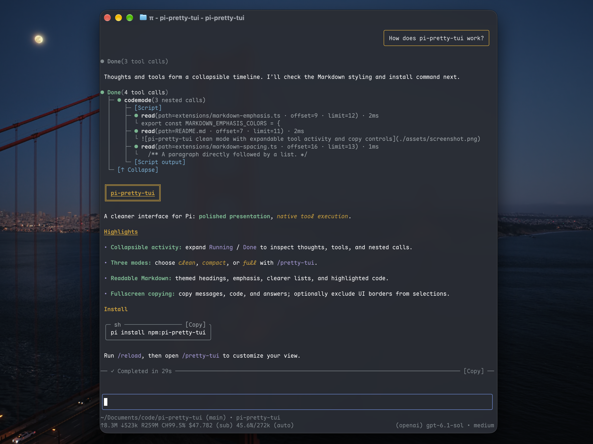

# pi-pretty-tui

English | [简体中文](./README.zh-CN.md)

A cleaner, theme-aware interface for the [Pi coding agent](https://pi.dev/), with collapsible tools and thoughts, rounded message cards, and convenient copying.



## Install

```sh
pi install npm:pi-pretty-tui
```

Restart Pi or run `/reload`.

## Rendering modes

Run `/pretty-tui` to open settings and choose a mode:

| Mode | Experience |
|---|---|
| **clean** (default) | Group tools and thoughts into a collapsible `Running` / `Done` timeline. |
| **compact** | Show separate tool and thought cards with concise previews; expand for details. |
| **full** | Keep Pi's native details and interactions inside themed cards, with thoughts initially expanded. |

All modes include rounded messages and code blocks, syntax highlighting, a live working timer, and final-answer duration and copy controls. Clean and compact also support expandable nested-tool trees.

Click activity rows, tool titles or thought entries to expand and collapse details. In clean, use these local controls; in compact and full, Pi's `Ctrl+O` and `Ctrl+T` shortcuts remain available.

| Command | Action |
|---|---|
| `/pretty-tui clean` | Switch to clean mode |
| `/pretty-tui compact` | Switch to compact mode |
| `/pretty-tui full` | Switch to full mode |
| `/pretty-tui enable` / `/pretty-tui disable` | Enable or disable the extension and reload |
| `/pretty-tui status` | Show current settings |

Settings persist across sessions. Disabling the extension restores Pi's native appearance.

## Markdown readability

- Consistent transcript list spacing, including nested and task lists, without doubled gaps.
- Assistant bold and italic text use theme-aware colors; set `"markdownEmphasis": "native"` in `pretty-tui.json` and run `/reload` to keep native colors.
- H2 uses the theme heading color and bold without a filled label; other heading levels retain their existing treatments.

Original Markdown, inline-code/link styling and wrapping are preserved. See [Markdown readability](./docs/markdown-readability.md) for details.

## Copying

Start Pi in **fullscreen mode** to use mouse controls:

```sh
pi --tui-mode fullscreen
```

- **User message:** click its body or border to copy the original text.
- **Code block:** click `[Copy]` to copy the code without its frame.
- **Final answer:** click `[Copy]` beside the response duration to copy the answer without thoughts or tool output.

Dragging selects text rather than copying a whole message. Links keep their normal behavior; image attachments are not included in text copies.

### Optional border-free selection

Enable **Selection copy** in `/pretty-tui`, or run:

```text
/pretty-tui selection-copy on
/pretty-tui selection-copy off
```

This experimental option is **off by default**. In fullscreen mode, it removes UI borders, titles and layout padding from copied selections while preserving literal box-drawing characters in the content. It works in all three rendering modes; toggling it saves the setting and reloads Pi.

In regular mode, the terminal handles selection and copying, so this option has no border-removal effect. Fullscreen/regular is independent of clean/compact/full.

## Notes

- Tested with **Pi 1.4.0**. Future Pi updates may require compatibility fixes.
- Keeps Pi's native input behavior and tool execution, including third-party tool implementations.
- Nested-tool text details are saved with sessions for restoration and may be truncated. Session files can contain sensitive tool output.
- See [Releases](https://github.com/ykn0309/pi-pretty-tui/releases) for changes and contributor acknowledgments.

## Development

See [local development and tests](./docs/development.md) for working from a checkout with `pi -e .` and `/reload`. Keep project-local `.pi/settings.json` out of commits.

## Uninstall

```sh
pi remove npm:pi-pretty-tui
```

Restart Pi afterward.

## License

[MIT](./LICENSE)
