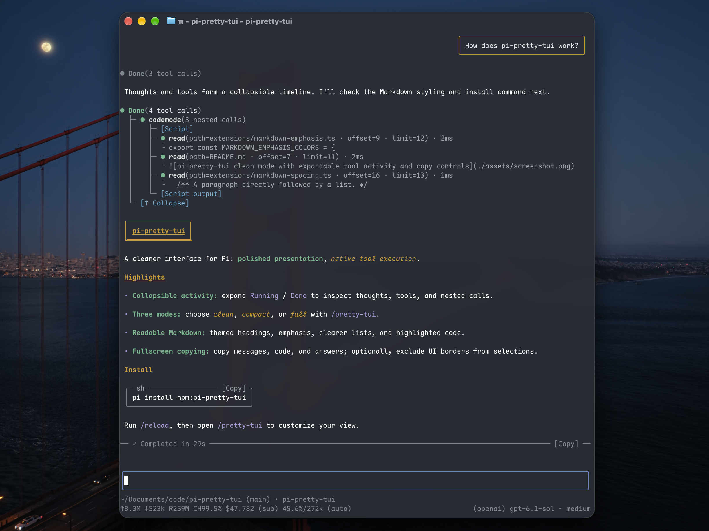

# pi-pretty-tui

[English](./README.md) | 简体中文

为 [Pi coding agent](https://pi.dev/) 提供更清爽的界面：可折叠的工具与思考、跟随主题的圆角卡片，以及便捷的复制操作。



## 安装

```sh
pi install npm:pi-pretty-tui
```

安装后重启 Pi，或运行 `/reload`。

## 展示模式

运行 `/pretty-tui` 打开设置，选择模式：

| 模式 | 展示方式 |
|---|---|
| **clean**（默认） | 将工具与思考归入可折叠的 `Running` / `Done` 活动时间线。 |
| **compact** | 工具与思考分别显示为简洁卡片，展开查看详情。 |
| **full** | 在主题卡片中保留 Pi 原生详情与交互，思考默认展开。 |

三种模式均提供圆角消息与代码块、语法高亮、实时工作计时，以及回答末尾的耗时和复制入口。clean 和 compact 还支持展开查看嵌套工具调用。

点击活动行、工具标题或思考条目可展开、收起详情。clean 使用这些局部入口；compact 和 full 保留 Pi 的 `Ctrl+O`、`Ctrl+T` 快捷键。

| 命令 | 作用 |
|---|---|
| `/pretty-tui clean` | 切换到 clean |
| `/pretty-tui compact` | 切换到 compact |
| `/pretty-tui full` | 切换到 full |
| `/pretty-tui enable` / `/pretty-tui disable` | 启用或禁用插件，并自动重载 |
| `/pretty-tui status` | 查看当前设置 |

设置会持久保存。禁用插件后恢复 Pi 原生外观。

### 重复错误

clean 和 compact 中，相邻的独立错误即使 trace、request 或 correlation ID 不同，也可合并显示第一条完整错误及 `×2` / `×3` 次数。来源类型、标题和周围文本必须完全一致；仅独立的长十六进制 ID（16–128 位且含字母）或 UUID 可以变化。短错误码、纯数字值及 `msg_...` / `rs_...` 等带前缀的标识仍要求一致。

其他会话条目会打断合并；带思考、工具调用或可见回答的错误不参与折叠。会话记录保持不变，使用 `/pretty-tui full` 可查看每次错误及原始 ID。

## 复制操作

以 **fullscreen 全屏模式**启动 Pi，即可使用鼠标复制入口：

```sh
pi --tui-mode fullscreen
```

- **用户消息：** 点击正文或边框，复制原始文本。
- **代码块：** 点击 `[Copy]`，复制不含边框的代码。
- **最终回答：** 点击回答耗时旁的 `[Copy]`，复制不含思考和工具输出的回答。

拖动鼠标按选区处理，不触发整条消息复制。链接保留正常行为；文本复制不包含图片附件。

### 可选的无边框选区复制

在 `/pretty-tui` 中切换 **Selection copy**，或运行：

```text
/pretty-tui selection-copy on
/pretty-tui selection-copy off
```

这是**默认关闭的实验性选项**。在全屏模式下，复制鼠标选区时排除界面边框、标题和布局留白，保留正文里真实存在的框线字符。适用于三种展示模式，切换后保存设置并自动重载 Pi。

regular 非全屏模式由终端处理选择与复制，开启此选项也不会获得边框排除效果。fullscreen／regular 与 clean／compact／full 是两组独立设置。

## 必要说明

- 当前已在 **Pi 1.4.0** 上测试；未来 Pi 更新可能需要适配。
- 保留 Pi 原生输入行为和工具执行逻辑，包括第三方工具实现。
- 嵌套工具的文本详情会随会话保存以便恢复，内容可能截断；会话文件可能包含工具输出中的敏感信息。
- 版本变更与贡献者致谢见 [Releases](https://github.com/ykn0309/pi-pretty-tui/releases)。

## 卸载

```sh
pi remove npm:pi-pretty-tui
```

卸载后重启 Pi。

## 许可证

[MIT](./LICENSE)
